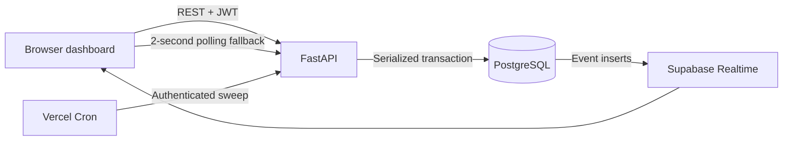

# Relay — Last-Mile Spoilage Trap

A deterministic dispatch platform connecting donors, volunteer riders, and shelters. FastAPI coordinates time-sensitive allocations in PostgreSQL; a single-file dashboard provides donor, rider, shelter, and operations views. There is no AI/ML component.

## Run locally

Use Python 3.12 and PostgreSQL 16. The project was also validated with the available Python 3.13 interpreter.

PowerShell, from the repository root:

```powershell
python -m venv .venv
.venv\Scripts\python -m pip install -r requirements.txt
Copy-Item .env.example .env
docker compose up -d
# Wait for PostgreSQL to accept connections before initializing.
.venv\Scripts\python -m scripts.init_db
.venv\Scripts\python -m scripts.seed
.venv\Scripts\python -m uvicorn app.main:app --reload --host 127.0.0.1 --port 8000
```

Open [Relay](http://127.0.0.1:8000) or [API documentation](http://127.0.0.1:8000/api/docs).

On macOS/Linux, use `.venv/bin/python` instead. Set unique, random `JWT_SECRET` and `CRON_SECRET` in `.env`. The checked-in example contains placeholders only; `.env` is ignored. To generate a value:

```powershell
.venv\Scripts\python -c "import secrets; print(secrets.token_urlsafe(48))"
```

The schema initializer is for a new database. `schema.sql` is the source of truth for constraints, indexes, and initial app state; the application does not use `Base.metadata.create_all()`.

For this Windows workspace, portable PostgreSQL has already been initialized under the ignored `.runtime/` directory. Its app and test databases share port 5432, and `.env` reflects that. Start it and the app again with:

```powershell
powershell -ExecutionPolicy Bypass -File scripts/start-local.ps1
```

The helper only uses existing PostgreSQL files. It does not download or install software. Standard Docker setup uses separate ports: app 5432, tests 5433. Prefer `127.0.0.1` in database URLs if Windows stalls while resolving `localhost`.

## Sign in

The default demo password is `demo1234`; change it through `DEMO_PASSWORD` before seeding to use another password.

| Role | Example email |
| --- | --- |
| Admin | `admin@demo.local` |
| Donor | `banquet.hall@demo.local` |
| Rider | `r2@demo.local` |
| Shelter | `shelter.a@demo.local` |

The seed creates one account for each CSV entity, using lowercase names with spaces replaced by dots. It loads donors, riders, shelters, and demands, but creates no batches. **Seed replaces all demo users, deliveries, batches, and events.** Seeded user IDs are deterministic so the admin session remains usable after a reset.

Public registration allows donor/rider/shelter roles only. Admin accounts are created by the seed, never through registration.

## Judge walkthrough

Sign in as admin. The Operations panel provides the demo bar, rider fleet, shelter controls, map, delivery table, and event stream. Keep the page open so demo riders send heartbeats every 15 seconds. The admin heartbeat simulation is enabled only in demo mode.

1. Click **Seed**, then run **Main · 180 meals**. Four available riders reserve 40 units each; 20 remain unassigned with `NO_RIDER`. R5 starts offline.
2. Click **Silence** for R2, then **Accept all riders**. Advance time by **+5 min** and **+1 min**. R2 becomes unresponsive, its claim expires, and the batch has 60 unassigned units. The other riders keep their cargo.
3. Click **Online** for R5. It receives 40 units immediately; 20 remain unassigned.
4. Close a shelter with an active delivery, or click **Manage** and record a 50-unit cooked-food walk-in. Affected cargo reroutes synchronously when a compatible shelter can take the complete assignment. Otherwise an in-flight assignment becomes `STRANDED`, with its reservation released and an alert event.
5. **Seed**, choose **Tight · insulin**, and run. The API returns HTTP 422, preserves the batch as `INFEASIBLE`, and reports `TIME_INFEASIBLE` plus the best-case ETA.
6. **Seed**, run **Compatibility**. Rations go only to A/B; formula goes only to A/C. C lacks fuel and D lacks clean water.
7. After pickup/departure, silence a rider and advance two minutes using **+1 min** twice. The original assignment becomes `LOST`; a recovery batch is created at the last known rider position and planned when feasible. Cargo already past its safe deadline is spoiled instead of being offered for rescue.

Use the **Donors**, **Riders**, and **Shelters** tabs to inspect the corresponding role workflows. A non-admin account can access only its role's own data. The shelter panel supports category demand, safety flags, open/close, incoming deliveries, and walk-ins. Rider actions are Pickup → Depart → Deliver; cancellation is allowed before pickup.

## Engine and data flow



Every engine mutation runs inside PostgreSQL advisory transaction lock `727001`. Row locks and the partial unique index additionally protect demand and enforce one active assignment per rider. Routers own commits; engine functions never commit. Database dependencies roll back exceptions.

The planner accounts for rider → donor travel, readiness waiting, a three-minute loading interval, donor → shelter travel, and the batch safety buffer. Haversine distance is multiplied by 1.3 and converted using rider speed. Riders nearest the donor are considered first; a destination that accepts the whole chunk is preferred, then the earliest arrival. Splits respect rider capacity and remaining shelter demand.

Compatibility rules are centralized in `app/rules.py` and checked during planning, rerouting, pickup, and delivery. Rations require fuel and water; formula requires water; cold-chain cargo requires refrigeration.

The sweep expires ghost claims, detects stale heartbeats, handles lost cargo, spoils overdue deliveries, reroutes invalid destinations, retries stranded cargo, wastes unassigned cargo at cutoff, and plans remaining batches by earliest expiry. Failed claims/lost assignments exclude that rider from the original batch's next plan. Recovery batches retain the original expiry and record a parent link.

For each batch:

```text
quantity_total = unassigned + wasted + lost + active assignment units + delivered units
```

Recovery is a separate batch: the original ledger records its lost units, while the recovery ledger records rescue work. Do not interpret the sum of both batch totals as unique donated inventory.

Only `app/clock.py` reads wall time. Simulated offsets live in `app_state`, shared by serverless instances. Time travel also shifts non-silenced heartbeat timestamps. The sweep runs lazily on authenticated data requests with a one-second throttle, through cron, and synchronously after relevant state changes. There are no persistent workers or FastAPI WebSockets. Engine functions explicitly flush changes before subsequent queries because SQLAlchemy autoflush is disabled.

The tight CSV has no medical-demand row. Its feasibility gate also evaluates the physical best-case journey independently of current demand, ensuring it reports the impossible deadline rather than only a missing-demand reason.

## Realtime and security

Configure `SUPABASE_URL` and `SUPABASE_ANON_KEY` to enable browser Realtime. The dashboard subscribes to inserts into `events`, debounces refreshes by 300 ms, and retains polling every two seconds plus a five-second panel refresh. With no Supabase configuration, polling alone works.

The dispatch map uses OpenStreetMap's canonical tile endpoint. Tile images explicitly use `strict-origin-when-cross-origin`, so OpenStreetMap receives the site origin required by its usage policy. The app-wide `no-referrer` header remains in place for other resources. Do not remove the tile-specific policy: doing so can produce “403 Access blocked” map tiles.

JWTs use HS256 and real-time expiry; passwords use bcrypt directly. Requests enforce role and ownership checks, and ownership mismatches return 404. Input schemas forbid extra fields and enforce the specified ranges. Batch create/dispatch accept `Idempotency-Key` and persist the response in the same transaction. Cron authenticates using a constant-time comparison of its bearer secret. Slowapi limits auth to 10 requests/minute and other endpoints to 120/minute per IP and endpoint. CORS uses an explicit allowlist; production refuses `*`. Responses include security headers and structured errors.

Event payloads contain IDs, quantities, states, categories, timing values, and reason codes; they exclude names, emails, and coordinates. Browser data reads use the authenticated API. Supabase RLS exposes only events to the anonymous browser role.

## Tests and smoke check

```powershell
.venv\Scripts\python -m pytest -q
node tests/test_refresh.cjs
.venv\Scripts\python -m scripts.smoke
```

Tests use real PostgreSQL through `TEST_DATABASE_URL`. The test database name must end in `_test`. The test setup recreates its public schema, then clears test data between integration tests. **Never point the test URL at production or a database containing valuable data.**

The 31 checks cover the required judge scenarios, quantity conservation, concurrent dispatch, unique rider reservations, lifecycle guards, pickup/delivery expiry, compatibility, ownership/RBAC, rate limits, validation, idempotency, demo route exclusion, time travel, and the full judge API walkthrough. They use explicit engine timestamps without sleeps.

The optional Node.js regression check verifies that refreshes keep the rider card visible while waiting for the API and preserve it on network failures. The smoke command checks the running local HTTP server, login, authentication, and admin overview. It does not seed or create batches. Browser visual verification remains pending: the browser permission gate denied access to the local origin during this build. Supabase WebSocket delivery and hosted behavior also require a configured deployment to verify.

## Supabase + Vercel deployment

1. Create a Supabase project. Run `schema.sql`, then `supabase_extras.sql` in its SQL editor. The extras enable RLS and publish the events table for Realtime; they are not part of local initialization.
2. Set `DATABASE_URL` to the Supabase **transaction pooler**, port 6543, with the `postgresql+psycopg://` prefix. SQLAlchemy uses `NullPool` and disables prepared statements for pooler compatibility.
3. Deploy this repository to Vercel with the FastAPI framework preset. Vercel detects `app/main.py` and preserves the API paths; `api/index.py` also exports the app for legacy setups. Do not rewrite API paths to `/api/index.py` with the native FastAPI preset. `public/index.html` is served statically by Vercel, while FastAPI mounts it only for local use. `vercel.json` schedules `/api/internal/sweep` daily, which is compatible with Hobby. Interactive requests also trigger throttled sweeps.
4. Configure `DATABASE_URL`, random `JWT_SECRET`, `JWT_EXP_MINUTES`, random `CRON_SECRET`, `ALLOWED_ORIGINS` set to your deployed origin, `DEMO_MODE`, `DEMO_PASSWORD`, `SUPABASE_URL`, and `SUPABASE_ANON_KEY` in Vercel.
5. Seed the initialized database using `python -m scripts.seed` with the intended deployment environment. Sign in, click Seed if needed, and run the walkthrough. Initial seeding is required before any admin can sign in.
6. Vercel Cron sends `Authorization: Bearer $CRON_SECRET`. The committed daily schedule works on Hobby. On Pro, optionally change it to `* * * * *` for minute-frequency sweeps while nobody is using the app. Request-driven sweeps remain available while users interact with the app. See [Vercel cron limits](https://vercel.com/docs/cron-jobs/usage-and-pricing).
7. Set `DEMO_MODE=false` outside judging and restart/redeploy. All `/api/demo/*` routes then return 404. Use non-demo accounts and strong credentials for real use.

No hosted deployment was created during the build. Supabase/Vercel project credentials were not configured. The committed files and instructions are ready for deployment configuration.
